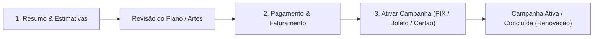

# 📄 PRD — Nova Página de Propostas & Checkout Multi-Canal (Aqui Ads)

> **Status:** Homologado em Protótipo de Alta Fidelidade | **Versão:** 1.0  
> **Owner:** Produto (Aqui Ads)  
> **Protótipo Interativo (GitHub Pages):** [Acessar Página de Propostas](https://nataliaferreira-aqui-globo.github.io/pagina-de-propostas/prototipo/)  
> **Repositório:** `nataliaferreira-aqui-globo/pagina-de-propostas`

---

## 1. Visão Geral & Contexto de Negócio

A **Página de Propostas** é o ponto crítico de conversão (*Bottom of Funnel*) da jornada comercial e self-service do **Aqui Ads**. É nela que o anunciante (PME ou agência) analisa o plano de mídia recomendado, valida entregas estimadas, compartilha o material internamente (via link, PDF ou Excel), preenche seus dados de faturamento e ativa a campanha realizando o pagamento.

### 1.1 Problemas que estamos resolvendo (Dores Mapeadas)
1. **Fricção cognitiva no entendimento do Mix de Mídia:** Propostas multi-canal misturavam métricas de naturezas diferentes (impactos de OOH, impressões de Digital/Revistas e inserções de Rádio), gerando confusão sobre o que está sendo comprado.
2. **Abandono no cadastro de faturamento:** Quando a PME ainda não possuía CNPJ/CPF cadastrado, a abertura simultânea de mais de 8 campos quebrava o grid da tela e gerava fadiga visual.
3. **Atrito no Checkout Mobile (PIX, Boleto e Rádio à parte):** No celular, o usuário precisava rolar excessivamente após clicar em PIX, via um QR Code inútil (já que estava no próprio celular), tinha dúvidas sobre o estado do botão após gerar o código e via o card de faturamento à parte de Rádio antes do botão principal de pagamento.
4. **Inviabilidade de compartilhamento do PDF no WhatsApp/E-mail:** O PDF gerado em produção pesava **`18,77 MB`**, estourando limites de anexo de e-mail corporativo e demorando para baixar no 4G.
5. **Planilha Excel sem hierarquia visual nem filtros:** O arquivo exportado dificultava a análise tática por parte de clientes e agências.

### 1.2 Objetivos de Negócio (Outcomes Esperados)
* **Aumentar a taxa de conversão de Proposta → Pagamento Iniciado/Concluído** (especialmente no tráfego Mobile vindo de WhatsApp e CRM).
* **Reduzir o tempo de aprovação interna do cliente** por meio de exportações executivas leves (PDF de `0,30 MB` e Excel estilizado com autofiltros).
* **Zerar cliques duplicados e dúvidas pós-geração de PIX/Boleto** com estados claros de transição (`ativar minha campanha` → `aguardando pagamento`).

---

## 2. Arquitetura da Jornada & Estrutura da Página

A página é estruturada em **3 blocos permanentes no topo** seguidos por **3 abas de navegação**:

1. **Stepper de Jornada:**
   * `1. Resumo` → `2. Pagamento` → `3. Ativar campanha` (atualiza o rótulo do passo 3 dinamicamente para `Campanha ativa` ou `Campanha concluída`).
2. **Hero Executivo da Proposta:**
   * Dados da campanha, Dados de faturamento (com *Progressive Disclosure*) e Card de Investimento Total.
3. **Seção de Estimativa de Entrega do Plano:**
   * Cards modulares adaptados automaticamente ao mix de canais contratados.
4. **Abas de Conteúdo:**
   * **Aba 1:** `Plano de mídia` (*Mobile:* `Plano`)
   * **Aba 2:** `Especificações de arte` (*Mobile:* `Artes`)
   * **Aba 3:** `Pagamento e aprovação` (*Mobile:* `Pagamento`)

---

## 3. Regras de Negócio Detalhadas por Seção

### 3.1 Hero da Proposta & Ciclo de Vida de Status

| Status da Proposta | Badge Semântica | Comportamento do Card Financeiro & Ações |
| :--- | :--- | :--- |
| **Aguardando pagamento** | Âmbar (`Aguardando pagamento`) | Exibe botão `alterar proposta` no topo, gaveta de cupom ativa e CTA primário `efetuar pagamento`. |
| **Campanha ativa** | Azul (`Campanha ativa`) | Oculta botões de edição/cobrança, exibe confirmação de pagamento compensado e resumo da forma de pagamento utilizada. |
| **Campanha concluída** | Verde (`Campanha concluída`) | Exibe CTA de retenção/recompra **`renovar campanha`** (no topo e no card direito), direcionando para `/campanhas/:id/detalhamento-anuncio`. |

---

### 3.2 Cadastro de Dados de Faturamento (Sem CNPJ/CPF Prévio)

> **Regra Inegociável de Layout:** A abertura do formulário de faturamento **nunca deve quebrar ou desalinhar o grid lateral esquerdo** em relação ao card financeiro da direita. O formulário abre dentro do próprio card ou em gaveta controlada mantendo a estrutura da página intacta.

Para evitar que o usuário sofra visualmente ao preencher os dados de Pessoa Jurídica (PJ) ou Pessoa Física (PF), aplicamos **Revelação Progressiva (*Progressive Disclosure*) em 2 micro-passos**:

1. **Seletor de Personalidade Fiscal (Pills):** Alternância imediata entre `Pessoa Jurídica (CNPJ)` e `Pessoa Física (CPF)`.
2. **Passo 1 — Identificação Fiscal:**
   * **Se Pessoa Jurídica (PJ):**
     * `CNPJ` (com máscara `00.000.000/0000-00` e **auto-preenchimento** da Razão Social ao completar 14 dígitos).
     * `Razão Social`.
     * `Inscrição Estadual` com botão rápido **`Isento`** integrado ao campo.
   * **Se Pessoa Física (PF):**
     * `CPF` (máscara `000.000.000-00`).
     * `Nome completo`.
     * `Data de nascimento`.
3. **Passo 2 — Endereço Inteligente via CEP:**
   * Inicialmente exibe **apenas o campo `CEP`**.
   * Ao digitar os 8 dígitos do CEP, o sistema consulta e preenche automaticamente **Logradouro, Bairro, Cidade e UF** em uma pílula-resumo compacta (com opção `Editar`), abrindo apenas os campos **`Número`** e **`Complemento`** para digitação manual.

---

### 3.3 Separação Financeira: Checkout Imediato vs. Rádio CBN

Como o produto **Rádio CBN** possui reserva de grade e faturamento em boleto dedicado pós-confirmação com o time de especialistas:
* **Cenário Multi-canal (OOH/Digital/Revistas + Rádio):**
  * O card de **Investimento total** exibe o valor global da proposta, mas subdivide visualmente em um box informativo:
    1. **Checkout imediato** (`Até 6x s/ juros, Pix ou Boleto`): soma apenas OOH + Portais + Revistas.
    2. **Pós-reserva (Rádio)** (`Boleto após confirmar grade`): exibe o subtotal de Rádio CBN.
* **Cenário Exclusivo Rádio (100% Rádio):**
  * Oculta a ancoragem de parcelamento em 6x e exibe o aviso de **Faturamento à parte**.

---

### 3.4 Estimativa de Entrega do Plano (Métricas Modulares)

* **Regra Multi-canal (2 a 4 canais na proposta):**
  * Renderiza 1 card por canal ativo, mantendo **alinhamento horizontal estrito** entre os títulos, o número principal (KPI) e a linha divisória das 4 sub-métricas inferiores:
    * **OOH:** KPI = `Impacto no período` | Sub-métricas: `Pontos`, `Telas`, `Exibições` (ou `Fixa`), `Alcance`.
    * **Portais e Globoplay:** KPI = `Impressões estimadas` | Sub-métricas: `Formatos`, `Veículos` (com popover `+N`), `Tipo de mídia`, `CPM médio`.
    * **Revistas e Jornais:** KPI = `Impressões estimadas` | Sub-métricas: `Títulos` (com popover `+N`), `Formato`, `Cobertura`, `CPM médio`.
    * **Rádio CBN:** KPI = `Inserções no período` | Sub-métricas: `Rádio/programa`, `Inserções/semana`, `Duração`, `Praça`.
* **Regra Monocanal (1 único canal na proposta):**
  * Expande as métricas daquele canal específico em cards individuais no topo, sem exibir cards zerados de canais não contratados.

---

### 3.5 Aba 1: Plano de Mídia, Mapa Interativo e Cards por Canal

#### A. Mapa Interativo OOH (Desktop vs. Mobile)
1. **Simetria de Altura no Desktop:** O componente do mapa lateral esquerdo possui **exatamente a mesma altura (`580px`)** do container da lista de cards à direita, mantendo alinhamento visual de topo e base.
2. **Mapa 100% Inline no Mobile (Zero Modal):** No mobile, o cabeçalho da seção OOH apresenta um *switcher* segmentado `Lista | Mapa`. Ao tocar em `Mapa`, o mapa renderiza inline no fluxo da página com botão `Voltar para a lista (N)`, evitando modais que prendam o scroll do usuário.

#### B. Padronização de Nomenclatura e Métricas nos Cards (Regra Anti-Redundância)

> **Regra de Nomenclatura e Não-Redundância nos Cards:**  
> 1. Cada canal deve usar sua unidade correta de mídia no canto superior direito do card.  
> 2. A métrica exibida no canto superior direito do card **não deve ser repetida** dentro da gaveta expansível (`Detalhamento de métricas`) nem no popover daquele card.

| Canal | Rótulo no Topo Direito (Mobile) | Rótulo no Topo Direito (Desktop) | Métricas na Gaveta Expansível (`Detalhamento de métricas`) | Regras Específicas do Card |
| :--- | :--- | :--- | :--- | :--- |
| **OOH** | **`impacto`** (no singular, ex.: `25.056 impacto`) | `IMPACTO ESTIMADO` | **4 itens:** `Telas`, `Exibições` (`Fixa` se estático), `Alcance`, `Frequência` | • **Mídia Estática (`IMPRESSO`):** Não exibir tag "Exibição fixa" no topo do card, pois já consta nas métricas. • **Condomínios:** Agrupar torres do mesmo condomínio em card único (`Coletânea ...` + badge `N torres`) com gaveta expansível para ver as torres. |
| **Portais e Globoplay (Digital)** | **`impressões`** (ex.: `180.000 impressões`) | `IMPRESSÕES ESTIMADAS` | **2 itens (`grid-cols-2`):** `Portais` e `CPM` *(Impressões removido por já constar no topo)* | • Exibe badge do formato (`DISPLAY` / `VÍDEO`) + veículos inclusos. |
| **Revistas e Jornais (Revistas Digitais)** | **`impressões`** (ex.: `94.000 impressões`) | `IMPRESSÕES ESTIMADAS` | **2 itens (`grid-cols-2`):** `Portais` e `CPM` *(Impressões removido por já constar no topo)* | • Exibe badge `DISPLAY`, título editorial (ex.: *O Globo*) e cobertura. |
| **Rádio CBN** | **`inserções`** (ex.: `28 inserções`) | `INSERÇÕES` | **3 itens (`grid-cols-3`):** `Frequência`, `Faixa horária` e `Duração` *(Inserções removido por já constar no topo)* | • Exibe badge `SPOT 30S` e indicação `Faturado à parte`. |

---

### 3.6 Aba 3: Pagamento e Aprovação (Desktop & Mobile)

#### 1. Comportamento do Botão Principal (`ativar minha campanha` → `aguardando pagamento`)
* Enquanto o usuário escolhe entre Cartão, PIX ou Boleto (e ainda não gerou o PIX/Boleto), o botão principal exibe **`ativar minha campanha`** com gradiente primário ativo.
* Assim que o usuário clica em **`ativar minha campanha`** para **PIX** ou **Boleto**:
  1. O código PIX ou a linha digitável do Boleto é gerada e exibida na seção da forma de pagamento escolhida.
  2. O botão principal muda imediatamente para o estado **inativo/desabilitado** (`disabled`), fundo cinza neutro, ícone de relógio e texto **`aguardando pagamento`**.
  3. A tela executa *smooth scroll* até a caixa do código gerado para o usuário copiar.

#### 2. Paridade de Ações entre PIX e Boleto
* **No PIX gerado:** Exibe o campo `Pix copia e cola` com os botões **`copiar código Pix`** e **`já paguei o Pix`** (em verde esmeralda, que confirma o pagamento e avança o status da proposta para `Campanha ativa`).
* **No Boleto gerado:** Segue exatamente o mesmo padrão visual e comportamental do PIX, exibindo a linha digitável com os botões **`copiar código do boleto`**, **`já paguei o boleto`** (em verde esmeralda) e **`baixar PDF`**.

#### 3. Regras Exclusivas de UX Mobile no Checkout
1. **Slider Automático ao clicar em PIX no Mobile:**
   * Quando o usuário está no **Mobile** e toca na opção **PIX**, a página faz *smooth scroll* automático direto até o botão **`ativar minha campanha`**, poupando rolagem manual.
2. **Omissão do QR Code no Mobile:**
   * No **Mobile**, **não é exibido o QR Code** (nem mencionado no texto pré-geração), pois o usuário já está navegando no próprio smartphone. É exibido apenas o código **Pix copia e cola** em largura total com os botões de copiar e confirmar pagamento. (No Desktop, o QR Code continua sendo exibido normalmente ao lado do código).
3. **Reordenação Hierárquica do Card de Rádio CBN no Mobile:**
   * Como o faturamento de Rádio CBN não ocorre no checkout online imediato, no **Mobile** o card `Rádio CBN — Checkout à parte` é posicionado **abaixo** do resumo financeiro e do botão **`ativar minha campanha`**, garantindo foco total na conversão imediata.

---

## 4. Exportação Executiva: PDF Comercial & Planilha Excel (`.xlsx`)

### 4.1 PDF Comercial da Proposta (`renderPdfDocument`)

#### A. Arquitetura de Paginação (Foco na 1ª Página)
* **Página 1 como Vitrine Executiva:** A primeira página concentra o cabeçalho institucional com KV, os 4 cards executivos de resumo (Campanha, Período, Faturamento e Investimento Total) e traz para cima a seção **Detalhamento de Métricas Estimadas por Canal**.
* **Regra de Quebra de Página dos Cards de Métricas:**
  * **Quando houver 4 cards de canais:** Os **2 primeiros cards** (`OOH` e `Portais e Globoplay`) ficam na **Página 1**, e a quebra de página ocorre **exatamente ao meio (2 + 2)**, posicionando os outros 2 cards (`Revistas e Jornais` e `Rádio CBN`) no topo da **Página 2**, seguidos pelas tabelas de detalhamento do plano.
  * **Quando houver 1 ou 2 cards de canais:** Todos os cards de métricas permanecem integralmente na **Página 1**.

#### B. Engenharia de Redução de Peso do PDF (WhatsApp & E-mail Ready)

> **Resultado da Otimização:** O peso do PDF caiu de **`18,77 MB`** (`19.225 KB` na versão atual de produção) para **`0,30 MB`** (**`309 KB`** no novo modelo) — uma **redução de 98,4%** (`-18,47 MB`), permitindo envio instantâneo via WhatsApp e anexo em qualquer servidor de e-mail.

* **Causas do peso antigo (`18,77 MB`) que devem ser evitadas na implementação:**
  * Uso de `jsPDF.addImage(..., "PNG")` com compressão padrão `NONE` para imagens full-HD (`8,10 MB` apenas no logo de encerramento `1920x1080`, `2,53 MB` no logo de topo e `8,06 MB` em 6 imagens de formatos).
* **Diretrizes Técnicas Obrigatórias para Engenharia:**
  1. Utilizar a imagem de cabeçalho pré-otimizada em JPEG (`kv-proposta-bg.jpg`, `450x315px`, `17,6 KB`) com o gradiente já incorporado na imagem, **sem uso de `-webkit-mask-image` em CSS** (que força o motor SkPDF do Chromium a converter o JPEG de `17 KB` em um bitmap `/FlateDecode` de `351 KB`).
  2. Manter `aria-hidden="true"` nos containers `.pdf-page-sheet` durante a impressão para evitar a geração de mais de `1.400` objetos de árvore estrutural (`StructTreeRoot`).
  3. Utilizar cores hexadecimais sólidas nas tabelas do PDF (evitando opacidades RGBA que geram grupos de transparência extras) e carregar pesos estáticos da fonte `Rethink Sans` (`400;600;700;800`) ou comprimir streams com `'JPEG'` / `'FAST'` caso gerados via `jsPDF`.

---

### 4.2 Planilha Excel da Proposta (`.xlsx`)

A exportação em Excel utiliza estilização executiva pronta para uso comercial:
1. **Resumo da Proposta Organizado no Topo:** Bloco superior estruturado com Código da Proposta, Anunciante, CNPJ, Período, Duração e Resumo Financeiro por Canal.
2. **Cabeçalhos de Seção em Laranja Aqui Ads (`#F97316`) com Texto Branco em Bold:** Destaque visual nas faixas divisórias e no cabeçalho da tabela de itens.
3. **Linha de Total em Negrito (Bold):** Somatório automático com tipografia em negrito, bordas superiores/inferiores reforçadas e máscara de moeda (`R$ #.##0,00`).
4. **Filtro Automático Ativo (`autoFilter`) e Painéis Congelados:** Todas as colunas da tabela detalhada (`Canal`, `Código / ID`, `Produto / Ponto`, `Categoria / Veículo`, `Formato`, `Cidade / UF`, `Endereço / Detalhe`, `Entrega Estimada`, `Valor Líquido`) já vêm com filtro nativo do Excel habilitado para facilitar a análise do cliente.

---

## 5. Matriz de Priorização (MoSCoW) & Critérios de Aceite

### 5.1 Escopo MoSCoW para Engenharia
* **Must Have (MVP Obrigatório):**
  * Novo Hero com grid esquerdo fixo + formulário de faturamento progressivo (PJ/PF + auto-preenchimento de CEP).
  * Cards de plano de mídia padronizados com unidade correta no topo (`impacto` em OOH mobile, `impressões` em Digital/Revistas, `inserções` em Rádio) e gaveta de métricas sem redundância.
  * Mapa OOH com mesma altura da lista no desktop (`580px`) e modo inline `Lista | Mapa` no mobile.
  * Fluxo de Checkout com estado `aguardando pagamento` pós-geração de PIX/Boleto, paridade do botão `já paguei o boleto`, omissão de QR Code no mobile, slider automático ao clicar em PIX no mobile e Rádio CBN posicionado abaixo do pagamento no mobile.
  * Exportação de PDF leve (`< 0,5 MB`) com quebra de página 2+2 nos cards de métricas e Excel estilizado com autofiltros.
* **Should Have (V1.1):**
  * Exclusão em massa de pontos/itens com recálculo dinâmico e botão de restauração.
  * Simulador de parcelamento refletido em tempo real no resumo lateral.
* **Won't Have (Fora de Escopo Atual):**
  * Pagamento online unificado de Rádio CBN junto com OOH/Digital (permanece faturado à parte pós-reserva de grade).

### 5.2 Checklist de Critérios de Aceite (QA / Homologação)
- [ ] **CA-01 (Faturamento):** Abrir o formulário de cadastro PJ ou PF quando não há CNPJ cadastrado **não** altera a largura nem quebra o alinhamento da coluna esquerda do Hero.
- [ ] **CA-02 (OOH Estático):** Cards de mídia estática (`IMPRESSO`) não exibem tag extra de "Exibição fixa", mantendo a informação apenas nas métricas.
- [ ] **CA-03 (Unidades e Métricas Mobile/Desktop):**
  - Cards OOH no mobile exibem `impacto` (no singular) no canto superior direito e 4 métricas na gaveta (`Telas`, `Exibições`, `Alcance`, `Frequência`).
  - Cards de Portais e Revistas Digitais exibem `impressões` no canto superior direito e apenas 2 métricas na gaveta (`Portais` e `CPM`).
  - Cards de Rádio CBN exibem `inserções` no canto superior direito e apenas 3 métricas na gaveta (`Frequência`, `Faixa horária`, `Duração`).
- [ ] **CA-04 (Checkout Mobile PIX & Rádio):** No mobile, clicar em PIX rola suavemente até `ativar minha campanha`; ao ativar, exibe apenas o código Copia e Cola (sem QR Code); e o card de Rádio CBN aparece abaixo do botão `ativar minha campanha`.
- [ ] **CA-05 (Trava de Botão PIX/Boleto):** Após gerar PIX ou Boleto, o botão `ativar minha campanha` fica inativo com o texto `aguardando pagamento`, e o card do Boleto apresenta os botões `copiar código do boleto` e `já paguei o boleto`.
- [ ] **CA-06 (PDF & Excel):** O PDF gerado possui menos de `500 KB` (`~309 KB`), traz as métricas na 1ª página (quebrando 2+2 quando houver 4 canais) e o Excel exportado possui cabeçalhos em laranja com texto branco em bold, totais em bold e filtro ativo em todas as colunas.
